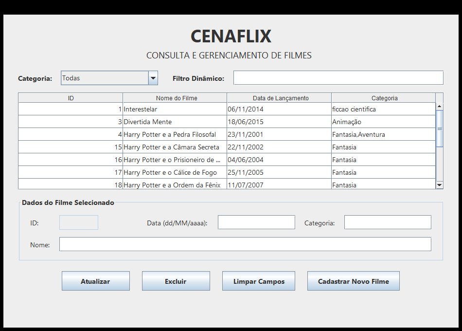
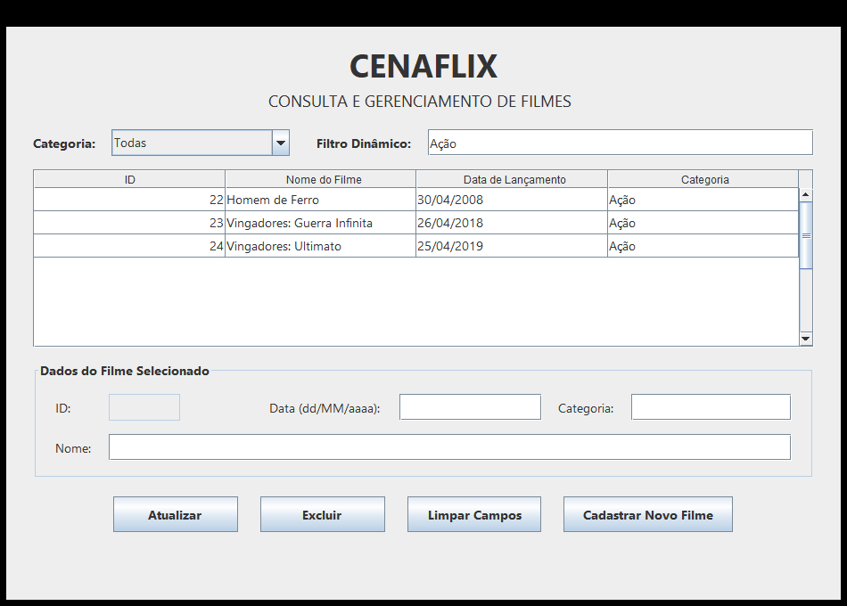

# 🎬 Cenaflix — Gerenciamento de filmes com Java e MySQL

Aplicação desktop desenvolvida como atividade acadêmica do curso Técnico em Desenvolvimento de Sistemas do Senac, utilizando **Java Swing, JDBC e MySQL**.

O sistema permite cadastrar, consultar, atualizar e excluir filmes, com validação de dados e filtros por categoria.

## Funcionalidades

- **Cadastrar** filmes com nome, data de lançamento e categoria.
- **Consultar** os registros em uma tabela (`JTable`).
- **Filtrar** filmes por categoria, usando uma lista de categorias cadastradas ou um campo de busca por prefixo.
- **Atualizar** os dados do filme selecionado, identificando-o pelo ID.
- **Excluir** filmes mediante confirmação.
- **Validar** campos obrigatórios, formato de data e tamanho dos textos antes de gravar alterações.

## Interface

**Consulta e gerenciamento de filmes**

**Filtro por categoria**

> O Cenaflix é um aplicativo desktop. As imagens mostram a interface; o sistema não é executado diretamente no GitHub.

## Tecnologias utilizadas

- **Java 21** — linguagem da aplicação.
- **Java Swing** — interface gráfica e componentes como `JTable` e `JOptionPane`.
- **JDBC + MySQL Connector/J 9.7.0** — comunicação entre Java e MySQL.
- **MySQL** — armazenamento dos registros.
- **Apache NetBeans + Ant** — edição visual dos formulários, compilação e geração do JAR.

## Organização do projeto

| Arquivo | Responsabilidade |
| --- | --- |
| `src/cenaflix/Cenaflix.java` | Ponto de entrada da aplicação. |
| `src/cenaflix/TelaInicial.java` | Cadastro de filmes e navegação para a consulta. |
| `src/forms/FormConsulta.java` | Listagem, filtro, edição e exclusão de filmes. |
| `src/cenaflix/beans/Filme.java` | Modelo dos dados: ID, nome, data e categoria. |
| `src/cenaflix/dao/FilmeDAO.java` | Operações SQL de inserção, consulta, atualização e exclusão. |
| `src/cenaflix/Conexao.java` | Abertura de conexões JDBC com configurações locais. |
| `database/schema_exemplo.sql` | Script para criar um banco de testes compatível com o código. |

Os arquivos `.form` acompanham as telas para permitir sua edição no construtor visual do NetBeans. Os arquivos `build.xml`, `manifest.mf` e `nbproject/` fazem parte da configuração do projeto Ant.

### Fluxo de uma operação

A tela recebe e valida os dados → cria ou utiliza um objeto `Filme` → chama um método de `FilmeDAO` → o DAO executa o SQL no MySQL por meio de uma conexão JDBC → a interface apresenta o resultado.

Os comandos que recebem valores usam **`PreparedStatement`**, e o DAO utiliza **`try-with-resources`** para liberar os recursos de conexão. As datas são representadas em Java por `LocalDate`.

## Como executar

O Cenaflix é uma aplicação desktop que utiliza **Java 21, NetBeans/Ant, JDBC e MySQL**. Para executá-la localmente, é necessário preparar o banco de dados, adicionar o driver JDBC e configurar a conexão.

**[Ver o guia completo de instalação e execução](docs/COMO_EXECUTAR.md)**

## Aprendizados e evolução

Este projeto permitiu praticar o **CRUD (Create, Read, Update e Delete)** de ponta a ponta: coletar dados na interface, validar entradas, executar consultas parametrizadas e apresentar os resultados de volta ao usuário. A separação entre modelo, conexão, DAO e telas ajudou a compreender a responsabilidade de cada parte da aplicação.

Como próximos passos, pretendo estudar **testes automatizados**, melhorar a atualização dinâmica dos filtros e executar operações de banco sem bloquear a interface gráfica.

---

**Projeto acadêmico — Carolina Rodrigues Pereira**  
[GitHub](https://github.com/carolinarope) · [LinkedIn](https://www.linkedin.com/in/carolina-rope/)
