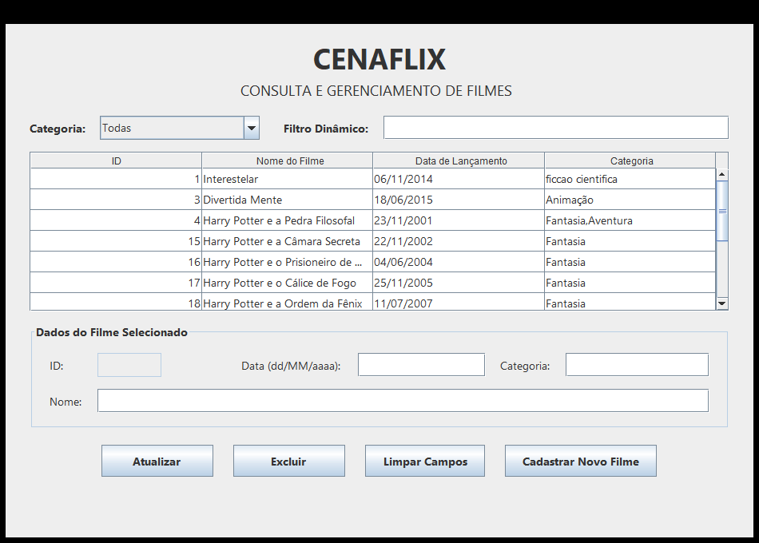
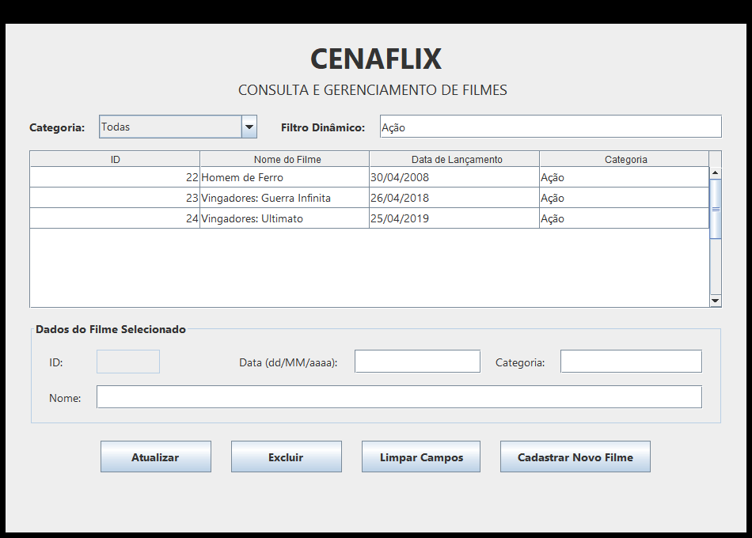

# 🎬 Cenaflix — Gerenciamento de filmes com Java e MySQL

Aplicação desktop desenvolvida como **projeto acadêmico do curso Técnico em Desenvolvimento de Sistemas do Senac**, com foco na integração entre **Java, interface gráfica e banco de dados relacional**.

O Cenaflix permite cadastrar e gerenciar filmes por meio de uma interface em **Java Swing**, utilizando **JDBC** para persistir os dados no **MySQL**.

## Funcionalidades

- **Cadastrar** filmes com nome, data de lançamento e categoria.
- **Consultar** os registros em uma tabela (`JTable`).
- **Filtrar** filmes por categoria, usando uma lista de categorias cadastradas ou um campo de busca por prefixo.
- **Atualizar** os dados do filme selecionado, identificando-o pelo ID.
- **Excluir** filmes mediante confirmação.
- **Validar** campos obrigatórios, formato de data e tamanho dos textos antes de gravar alterações.

## Interface

**Consulta e gerenciamento de filmes**



**Filtro por categoria**



> O Cenaflix é um aplicativo desktop. As imagens mostram a interface; o sistema não é executado diretamente no GitHub.

## Tecnologias utilizadas

- **Java 21** — linguagem da aplicação.
- **Java Swing** — interface gráfica e componentes como `JTable` e `JOptionPane`.
- **JDBC + MySQL Connector/J 9.7.0** — comunicação entre Java e MySQL.
- **MySQL** — armazenamento dos registros.
- **Apache NetBeans + Ant** — edição visual dos formulários, compilação e geração do JAR.

## Organização do projeto

| Arquivo | Responsabilidade |
| --- | --- |
| `src/cenaflix/Cenaflix.java` | Ponto de entrada da aplicação. |
| `src/cenaflix/TelaInicial.java` | Cadastro de filmes e navegação para a consulta. |
| `src/forms/FormConsulta.java` | Listagem, filtro, edição e exclusão de filmes. |
| `src/cenaflix/beans/Filme.java` | Modelo dos dados: ID, nome, data e categoria. |
| `src/cenaflix/dao/FilmeDAO.java` | Operações SQL de inserção, consulta, atualização e exclusão. |
| `src/cenaflix/Conexao.java` | Abertura de conexões JDBC com configurações locais. |
| `database/schema_exemplo.sql` | Script para criar um banco de testes compatível com o código. |

Os arquivos `.form` acompanham as telas para permitir sua edição no construtor visual do NetBeans. Os arquivos `build.xml`, `manifest.mf` e `nbproject/` fazem parte da configuração do projeto Ant.

### Fluxo de uma operação

A tela recebe e valida os dados → cria ou utiliza um objeto `Filme` → chama um método de `FilmeDAO` → o DAO executa o SQL no MySQL por meio de uma conexão JDBC → a interface apresenta o resultado.

Os comandos que recebem valores usam **`PreparedStatement`**, e o DAO utiliza **`try-with-resources`** para liberar os recursos de conexão. As datas são representadas em Java por `LocalDate`.

## Como executar

### Pré-requisitos

- **JDK 21**;
- **Apache NetBeans** com suporte a projetos Java SE/Ant;
- **MySQL Server** em execução (o MySQL Workbench pode ser usado para executar o script SQL);
- **MySQL Connector/J 9.7.0**.

### 1. Preparar o banco de dados

No MySQL Workbench, abra e execute o arquivo [`database/schema_exemplo.sql`](database/schema_exemplo.sql).

O script cria a base de testes `cenaflix` e a tabela `filmes`, com as colunas `id`, `nome`, `datalancamento` e `categoria`. A tabela começa vazia; os registros podem ser inseridos pela aplicação.

> O banco utilizado durante a atividade tinha o nome `ATIVIDADE1`. O script disponibilizado neste repositório é um **modelo independente para reprodução e testes**, não uma cópia do banco originalmente fornecido no curso.

### 2. Adicionar o driver JDBC

1. Baixe o [MySQL Connector/J](https://dev.mysql.com/downloads/connector/j/).
2. Na raiz do projeto, coloque `mysql-connector-j-9.7.0.jar` dentro da pasta `driver/` (crie a pasta, se necessário).
3. No NetBeans, confira a referência em **Propriedades do projeto → Bibliotecas**.

O arquivo `.jar` do driver não está incluído neste repositório. A configuração do projeto espera **esse nome e esse caminho**; se usar outra versão, será necessário ajustar as referências em `nbproject/project.properties`, `build.xml` e `manifest.mf`.

### 3. Configurar o acesso ao MySQL

A classe `Conexao` lê três **variáveis de ambiente**, em vez de armazenar usuário e senha no código:

| Variável | Exemplo ou orientação |
| --- | --- |
| `CENAFLIX_DB_URL` | `jdbc:mysql://localhost:3306/cenaflix` |
| `CENAFLIX_DB_USER` | Usuário MySQL com permissão para acessar e alterar a base. |
| `CENAFLIX_DB_PASSWORD` | Senha desse usuário, definida somente na sua máquina. |

No **Windows**, abra *Editar as variáveis de ambiente da sua conta*, cadastre os três valores em **Variáveis de usuário** e depois **reinicie o NetBeans**.

`localhost` indica o computador em que o MySQL está instalado. Se sua porta ou o nome do banco forem diferentes, adapte a URL. O projeto usa `System.getenv()` e **não carrega arquivos `.env` automaticamente**.

### 4. Abrir e iniciar o projeto

1. No NetBeans, escolha **Arquivo → Abrir projeto** e selecione a pasta que contém `build.xml`.
2. Confira se o projeto está usando o **JDK 21**.
3. Execute **Limpar e construir** para compilar e gerar o JAR.
4. Execute o projeto pela IDE. A classe principal é `cenaflix.Cenaflix`.
5. Cadastre um filme e abra **Consultar Filmes** para testar a listagem, a alteração e a exclusão.

Para iniciar o programa fora da IDE, após a compilação e com as variáveis configuradas:

```bash
java -jar dist/cenaflix_2.jar
```

Mantenha a pasta `dist/lib/` junto do JAR, pois ela contém o driver copiado durante a construção. O MySQL precisa estar acessível durante o uso.

## Aprendizados e evolução

Este projeto permitiu praticar o **CRUD (Create, Read, Update e Delete)** de ponta a ponta: coletar dados na interface, validar entradas, executar consultas parametrizadas e apresentar os resultados de volta ao usuário. A separação entre modelo, conexão, DAO e telas ajudou a compreender a responsabilidade de cada parte da aplicação.

Como próximos passos, pretendo estudar **testes automatizados**, melhorar a atualização dinâmica dos filtros e executar operações de banco sem bloquear a interface gráfica.

---

**Projeto acadêmico — Carolina Rodrigues Pereira**  
[GitHub](https://github.com/carolinarope) · [LinkedIn](https://www.linkedin.com/in/carolina-rope/)
